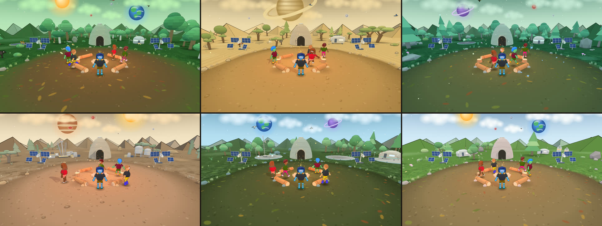

<div align="center">

# Skyke3D

**Jogo 3D social e multiplayer que roda no navegador.**<br>
Entre numa sala com os amigos, converse por voz, cante no karaokê, assista a vídeos e explore seis planetas inspirados nos biomas brasileiros, sem criar conta e sem instalar nada.

[](https://skyke3d.com.br)
[](https://github.com/Noturno-Strange/skyke3d/releases)
[](https://github.com/Noturno-Strange/skyke3d/actions/workflows/release.yml)
[](LICENSE)
[](package.json)
[](vendor/)
[](https://discord.gg/Xbr2FuDdy)



[Jogar](https://skyke3d.com.br) · [Recursos](#recursos) · [Rodar localmente](#começando) · [Arquitetura](#arquitetura) · [Documentação](#documentação) · [Contribuir](#contribuindo)

</div>

---

## Sumário

- [Visão geral](#visão-geral)
- [Recursos](#recursos)
- [Os mundos](#os-mundos)
- [Começando](#começando)
- [Como jogar](#como-jogar)
- [Publicar em produção](#publicar-em-produção)
- [Arquitetura](#arquitetura)
- [Desenvolvimento](#desenvolvimento)
- [Privacidade e segurança](#privacidade-e-segurança)
- [Documentação](#documentação)
- [Contribuindo](#contribuindo)
- [Créditos](#créditos)
- [Licença](#licença)

## Visão geral

O Skyke3D é um ponto de encontro em 3D: cada pessoa escolhe um nome e um avatar, entra numa sala e passa o tempo com quem estiver lá, conversando, cantando e assistindo a vídeos em volta de uma fogueira.

O projeto segue alguns princípios:

| Princípio | Na prática |
| --- | --- |
| **Sem conta** | Não há cadastro, e-mail nem senha. A identidade fica no navegador e vai para outro aparelho com um **código de recuperação**. |
| **Leve e próprio** | Servidor em Node.js com uma única dependência (`ws`). O three.js e todo o cliente são servidos pelo próprio projeto, sem CDN. |
| **Tudo por código** | Cenários, bichos, músicas lofi e efeitos sonoros são gerados por código, sem arquivos de áudio ou modelos 3D. |
| **Privado por padrão** | A voz passa pelo servidor do jogo, que só a repassa na hora, sem gravar; ninguém vê o IP de ninguém. O chat não é guardado e estranhos não veem o seu id de amigo. |
| **Um só padrão gráfico** | O visual é o mesmo para todos, sem níveis de qualidade, e funciona no computador e no celular. |

## Recursos

**Social**
- **Salas** com código ou link de convite: 16 pessoas por padrão (até 40 pelo painel) e até 20 bots para completar a turma. Os bots respondem com frases sorteadas, sem IA.
- **Voz em tempo real** com quem está perto na sala, pelo próprio WebSocket do jogo (funciona em qualquer rede, sem TURN), com volume nivelado automaticamente, "aperte para falar" opcional (tecla V), volume das vozes e filtros de microfone nos Ajustes.
- **Chat** da sala e **chat global**, **amigos** com presença e convites, e **notificações** que guardam convites e pedidos perdidos.

**Mídia em grupo**
- **Karaokê**: cole um link do YouTube, entre na fila e cante no microfone, um de cada vez.
- **Vídeos** sincronizados para a sala inteira (até 4 ao mesmo tempo).
- **Rádio (DJ)**: qualquer pessoa toca uma rádio online para todos.

**Mundo**
- **6 mundos**, cada um um bioma brasileiro, com vegetação, céu, luz, música lofi e som ambiente próprios.
- **Vida no cenário**: aves e animais 2D de cada bioma, partículas no ar, chuva passageira nos biomas em que chove e estrela cadente de vez em quando.
- **Culinária** na fogueira (62 receitas, várias dos biomas brasileiros), **mochila** com comidas e poções e **mascote virtual**.

**Você**
- **Avatar** com 13 rostos (um deles de óculos), pele, olhos, 34 cabelos, chapéu e roupas, em cores comuns e brilhantes.
- **Nome personalizado**: 12 cores e efeitos como brilho, neon, degradê, aurora, arco-íris e cometa, no rótulo e no chat.
- **Perfil público** opcional, com mural de recados e curtidas.

**Acessibilidade e plataformas**
- Tamanho da **interface** e do **texto** ajustáveis, tema claro, escuro ou automático, modo de **alto contraste**, respeito a "reduzir movimento" e navegação por teclado.
- Teclado e mouse no computador, botões na tela no celular, e instalação como **aplicativo (PWA)**.

## Os mundos

Todos os mundos têm fogueira central com troncos para sentar, uma casa lunar de superadobe com uma pequena horta ao lado, satélites com painéis solares, aerogeradores, uma colônia própria e um anel de montanhas em volta.

| Mundo | Bioma | Paisagem | Bichos |
| --- | --- | --- | --- |
| **Amazora** | Amazônia | floresta densa de árvores gigantes, fungos, névoa e chuvas frequentes | araras, tucano, anta e onça |
| **Cerron** | Cerrado | campo dourado, árvores tortas de tronco grosso, arbustos e pedras | arara-canindé, carcará, lobo-guará, ema e tamanduá |
| **Atlanthia** | Mata Atlântica | mata fechada e úmida, samambaias, bromélias, serras e neblina | tucano-de-bico-verde, saíra-sete-cores, cutia e quati |
| **Caatara** | Caatinga | chão seco, cactos, árvores tortas pequenas e serras rochosas | asa-branca, carcará, tatu-bola e calango |
| **Panthara** | Pantanal | planície alagada em volta de uma ilha seca e plataformas sobre a água | tuiuiú, garça, capivara e jacaré |
| **Pamphora** | Pampa | campo aberto com flores silvestres, poucas árvores e colinas largas | quero-quero, cavalo crioulo e veado-campeiro |

## Começando

### Requisitos

- [Node.js](https://nodejs.org) **18 ou superior** (o npm vem junto)
- Um navegador atual com WebGL (Chrome, Edge, Firefox ou Safari)

### Instalação

```bash
git clone https://github.com/Noturno-Strange/skyke3d.git
cd skyke3d
npm install
npm start
```

Abra <http://localhost:3000>. Para outra porta: `PORT=8080 npm start`.

Sem `PUBLIC_URL`, o servidor sobe em **modo desenvolvimento** e aceita conexões de endereços locais e de redes privadas (`10/8`, `172.16/12`, `192.168/16`, CGNAT `100.64/10`, IPv6 ULA `fc00::/7` e `*.ts.net`). `Host` e `Origin` continuam obrigatórios e precisam combinar.

### Voz no computador local

A voz vai pelo próprio WebSocket do jogo (`VOICE_TRANSPORT=ws`, padrão) e funciona com `npm start`, sem TURN, no computador ou na internet. Para testar a malha WebRTC antiga sem TURN, use `VOICE_TRANSPORT=webrtc npm run start:direct`.

### Problemas comuns

| Sintoma | Solução |
| --- | --- |
| Porta 3000 ocupada | `PORT=8080 npm start` |
| Outro aparelho da rede não abre o jogo | Libere a porta no firewall e use o IP local do computador |
| A voz não conecta | Confira a permissão do microfone no navegador; com `VOICE_TRANSPORT=webrtc`, configure o [TURN](docs/producao.md#voz-privada-e-turn-só-com-voice_transportwebrtc) |

## Como jogar

1. Abra <https://skyke3d.com.br>, informe a data de nascimento (o jogo é para maiores de 18 anos) e aceite os Termos.
2. Escolha nome, mundo e avatar (**🎲 Aleatório** sorteia um visual).
3. **✨ Criar sala** ou digite um código e **Entrar**; chame os amigos pelo **🔗 convite**.
4. O tutorial em quadrinhos, na página inicial, mostra o resto, um quadrinho por vez (◀ ▶, setas do teclado ou arrastando).

| Ação | Computador | Celular |
| --- | --- | --- |
| Andar | **W A S D** ou clique no chão | toque no chão |
| Pular · Sentar | **E** · **F** | botões na tela |
| Usar item da mão | **Espaço** | botão na tela |
| Girar a câmera | arrastar com o **botão direito** (um clique rápido leva a câmera para a frente do avatar) | — |

> **Guarde o código de recuperação** (Perfil › 🔑). Como não existe conta nem senha, é ele que leva nome, visual e amigos para outro aparelho.

## Publicar em produção

Em resumo:

1. Domínio com **HTTPS** e o Node atrás de um proxy (Nginx, Caddy ou Cloudflare Tunnel), com `BIND_HOST=127.0.0.1`.
2. `PUBLIC_URL` e `ORIGINS` com o endereço público.
3. Nada de TURN para a voz: ela vai pelo WebSocket do jogo. O TURN (coturn) só é preciso com `VOICE_TRANSPORT=webrtc`.
4. A pasta `data/` em disco, com backup: banimentos, denúncias, recordes, capacidade, nomes reservados, perfis, mascotes e culinária.
5. Um supervisor (systemd, por exemplo) para o servidor voltar depois de uma queda.

O passo a passo, com exemplos de configuração e a lista completa de variáveis de ambiente, está em **[Produção e operação](docs/producao.md)**. O painel `/status` (métricas, capacidade e moderação) está em **[Painel de status](docs/painel.md)**.

## Arquitetura

```text
 Navegador                                        Servidor (Node.js)
 ┌────────────────────────────────────┐ WebSocket ┌──────────────────────────────────────┐
 │ index.html + assets/ (scripts      │◀─────────▶│ server.js: HTTP, estáticos com hash, │
 │ comuns em ordem, three.js local)   │  JSON     │ WebSocket, salas e mensagens         │
 │ cena 3D, avatar, som sintetizado   │           │ lib/: validação, salas, karaokê,     │
 │ voz (Opus/ADPCM) ◀── WebSocket ───▶│ binário   │ vídeo, amigos, bots, rádio, perfis,  │
 └────────────────────────────────────┘           │ moderação, limites e persistência    │
                                                  └──────────────────────────────────────┘
```

O servidor valida estritamente cada mensagem (`lib/validate.js`), aplica limites por ação, exige um ticket de admissão com prova de trabalho e guarda só o mínimo em JSON (`data/`), sem banco de dados.

<details>
<summary><b>Estrutura do projeto</b></summary>

```text
index.html            página do cliente (referencia assets/)
assets/               cliente: app.css, catalog.js (itens, cores, mundos, limites), lofi.js (músicas),
                      app-*.js (cena, colônia, vida do cenário, avatar, som, rede, painéis, mídia,
                      amigos, mascote, culinária, voz, interface), intro.js, fonte e imagens do tutorial
server.js             servidor HTTP/WebSocket, painel e tratamento das mensagens
lib/                  módulos do servidor
status.html           painel /status
privacidade.html      Termos de Uso e Política de Privacidade (/termos e /privacidade)
profile.html          página do perfil público
tests/                testes (node:test) e apoios (harness, fontes do cliente e do servidor)
tools/                capturas dos mundos, auditorias de contraste e de áudio, teste de carga, galeria de cabelos
docs/                 produção, painel, segurança, funcionamento e imagens
pwa/                  manifesto, ícones e service worker do modo aplicativo
desktop/              exemplo de aplicativo Tauri para Linux (não é publicado)
vendor/               three.js r186 local, num arquivo só, com SHA-256 conferido
```

</details>

<details>
<summary><b>Notas técnicas</b></summary>

- **Motor 3D:** three.js r186 (0.186.1), servido de `/vendor/three-r186.min.js` com cache imutável. O three.js atual só vem como módulo ES; o arquivo é um pacote único gerado com esbuild que expõe `window.THREE` (a licença MIT fica no fim do arquivo):

  ```bash
  npm pack three@0.186.1 && tar -xzf three-0.186.1.tgz
  echo "import * as T from './package/build/three.module.js';window.THREE=Object.assign({},T);" > entry.js
  npx esbuild@0.25.0 entry.js --bundle --minify --format=iife --legal-comments=eof --target=es2020 --outfile=vendor/three-r186.min.js
  ```

  Para manter o visual afinado desde o r128, `assets/app-base.js` desliga a gestão de cor automática, multiplica as intensidades das luzes por π e devolve à luz da fogueira a queda antiga.
- **Visual toon:** luz em 3 faixas e contorno escuro tingido pela paleta de cada mundo; montanhas em tetraedro formando um anel de 360° (detalhes em [Como o jogo funciona](docs/funcionamento.md#cenários-dos-mundos)).
- **Estáticos e cache:** na inicialização o servidor calcula o SHA-256 dos arquivos do cliente e serve `/assets/<nome>.<hash>.<ext>` com `Cache-Control: immutable`; o HTML já aponta para os nomes com hash. Uma aba aberta durante um deploy pode receber 404 num arquivo antigo; recarregar resolve.
- **Desempenho:** `?perf` mostra FPS, chamadas de desenho e triângulos por quadro.
- **Código de recuperação:** montado e conferido no navegador (`assets/recovery.js`), em Base32 Crockford com 5 bytes de SHA-256 de conferência; nunca vai ao servidor.
- **Amigos:** a chave fica em `skyke_fk` e a lista (até 100) em `skyke_friends`, no navegador. O id público é um hash de 12 caracteres da chave, revelado só a quem a pessoa pede ou aceita; presença e convites só existem entre amigos mútuos.
- **Nomes:** únicos no servidor, sem diferenciar acento, maiúsculas, espaços ou letras parecidas, e reservados à chave do aparelho (`data/names.json`; até `NAMES_PER_KEY` nomes por chave e `NAMES_MAX` no total).
- **Compatibilidade do protocolo:** as ids dos planetas anteriores (`proxima`, `kepler`, `trappist`...) e as mais antigas (`aeris`, `brontis`, `marinis`...) são convertidas para o bioma mais parecido (`ST_LEGACY` em `assets/catalog.js`). A id interna é o nome em minúsculas e sem acento (`amazora`, `pamphora`...).
- **Sons:** sintetizados em Web Audio (efeitos, passos em areia, grama, água e pedra, ambiente, chuva e música lofi), com volumes calibrados por `tools/audio-audit.js`.
- **PWA sem cache:** o service worker não guarda nada (nem cache, nem dados do jogador) e, sem internet, mostra "Sem conexão".
- **Aplicativo de exemplo (Tauri):** a pasta `desktop/` abre o site numa janela própria, sem permissões de arquivos ou sistema. Para gerar um `.rpm`: `cd desktop && SKYKE_URL=https://seu-servidor/ npx @tauri-apps/cli@2.12.3 build --bundles rpm`.

</details>

## Desenvolvimento

| Comando | O que faz |
| --- | --- |
| `npm start` | sobe o servidor (porta 3000) |
| `npm run start:direct` | sobe com voz direta (só vale com `VOICE_TRANSPORT=webrtc`), para testar a malha sem TURN |
| `npm test` | suíte completa com `node:test` (589 testes) |
| `npm run check` | checagem de tipos do servidor e dos módulos compartilhados (TypeScript via JSDoc, sem gerar arquivos) |
| `npm run lint` | ESLint no servidor, nos testes e nas ferramentas |
| `npm run format` / `format:check` | Prettier em `server.js`, `lib/` e `tools/` |

Ferramentas em `tools/` (usam Chrome/Chromium headless; indique o binário com `CHROME=`):

| Ferramenta | Para quê |
| --- | --- |
| `node tools/world-shots.js --out pasta` | captura de cada mundo, com chamadas de desenho e triângulos, para comparar antes e depois |
| `node tools/contrast-audit.js` | contraste de todo texto visível nos temas escuro, claro e alto contraste (WCAG) |
| `node tools/audio-audit.js` | volume de cada som sintetizado contra o alvo da categoria |
| `node tools/tutorial-shots.js` | refaz as 10 imagens do tutorial (`assets/tut-*.jpg`) a partir do jogo atual |
| `node tools/loadtest.js` | teste de carga do servidor |

A suíte usa só `node:test` e o `ws`. Os testes de integração sobem o servidor numa porta livre (`tests/harness.js`) e são pulados quando `ws` ou o three.js local não existem. Os scripts `assets/app-*.js` ficam fora da checagem de tipos e do Prettier, porque muitos testes comparam trechos exatos do código.

### Releases

Cada push para `main` roda `npm ci`, os testes, a checagem de tipos, o lint, a formatação e `npm audit --omit=dev`; se tudo passar, o workflow cria um GitHub Release `vX.Y.Z` com a versão do `package.json` (actions fixadas por SHA e permissões mínimas). Para publicar, atualize a versão em `package.json`, `package-lock.json`, `desktop/src-tauri/Cargo.toml` e `desktop/src-tauri/Cargo.lock` e envie para `main`.

## Privacidade e segurança

- **Sem conta e sem dados pessoais:** o servidor não cria contas nem guarda mensagens do chat; a chave do aparelho só é usada enquanto a pessoa está na sala (a reserva de nomes guarda apenas um hash dela).
- **Anonimato na sala:** cada conexão aparece por um apelido aleatório, novo a cada entrada.
- **Moderação:** filtro de palavrões, denúncias com motivo, banimento progressivo, limite de mensagens, espera antes de falar no global e "silenciar só para mim", que esconde chat, emojis, gestos, convites e voz de alguém sem avisar a pessoa.
- **Servidor:** validação estrita de todas as mensagens, CSP com hashes, prova de trabalho na admissão, IP real atrás de proxy e limites por ação.

Detalhes em **[Segurança e moderação](docs/seguranca.md)** e na **[Política de Privacidade](privacidade.html)**. Se encontrar uma vulnerabilidade, avise os mantenedores em particular antes de divulgá-la publicamente.

## Documentação

| Documento | Conteúdo |
| --- | --- |
| [Produção e operação](docs/producao.md) | domínio, HTTPS, proxy (Caddy, Nginx ou Cloudflare Tunnel), voz pelo WebSocket, TURN opcional, variáveis de ambiente e supervisão |
| [Painel de status](docs/painel.md) | token, métricas, recordes, capacidade, teste de carga e moderação |
| [Segurança e moderação](docs/seguranca.md) | termos, filtro, denúncias, silenciar, limites e prova de trabalho |
| [Como o jogo funciona](docs/funcionamento.md) | cenários, vida do cenário, voz, karaokê, vídeo, amigos, culinária, bots, DJ e notificações |

## Contribuindo

Contribuições são bem-vindas. Para manter o projeto leve e coerente:

1. Abra uma issue descrevendo o problema ou a ideia antes de mudanças grandes.
2. Mantenha o escopo pequeno: sem banco de dados, sem upload de arquivos dos jogadores, sem níveis gráficos e sem novas dependências sem um bom motivo.
3. Rode `npm test`, `npm run check`, `npm run lint` e `npm run format:check` antes do pull request; mudanças visuais devem vir com capturas (`tools/world-shots.js`) e passar em `tools/contrast-audit.js`.
4. Escreva commits curtos no estilo do histórico (`feat:`, `fix:`, `chore:`).

## Créditos

- [three.js](https://threejs.org) (MIT), motor 3D
- [ws](https://github.com/websockets/ws) (MIT), WebSocket do servidor
- [Manrope](https://github.com/sharanda/manrope) (SIL Open Font License, em `assets/manrope-OFL.txt`), fonte da interface
- YouTube (domínio youtube-nocookie), players de karaokê e vídeo

## Licença

Copyright © 2026 Noturno-Strange.

Distribuído sob a **GNU General Public License v3.0** (`GPL-3.0-only`): você pode usar, estudar, modificar e redistribuir o código nos termos da licença, **sem qualquer garantia**. O texto completo está em [LICENSE](LICENSE).
