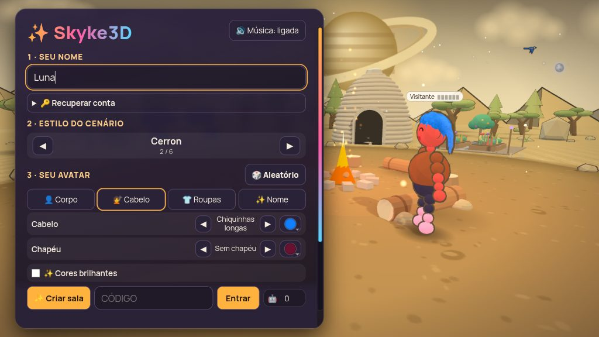

# Skyke3D

**Jogo 3D multiplayer no navegador.** Entre numa sala com os amigos, converse por voz, cante no karaokê, assista a vídeos e ouça rádio — sem criar conta e sem instalar nada.

**Jogar:** <https://skyke3d.com.br> · **Documentação:** [docs/](docs/) · **Licença:** [GPL-3.0-only](LICENSE)



## O que é o Skyke3D

O Skyke3D é um jogo 3D multiplayer que roda inteiro no navegador. Cada pessoa escolhe um nome e um avatar, entra numa sala e joga com quem estiver lá. Não existe cadastro nem senha: a identidade fica no próprio navegador e pode ser levada para outro aparelho com um **código de recuperação**.

O servidor é escrito em Node.js e conversa com o navegador por WebSocket. O jogo não depende de CDN: o three.js e todos os arquivos do cliente são servidos pelo próprio projeto.

## O que dá para fazer

- **Salas e bots.** Crie uma sala e convide com um código ou link. O padrão é 16 pessoas por sala (o painel permite até 40) e até 20 bots para completar a turma. Os bots não usam IA: respondem com frases sorteadas quando alguém escreve.
- **Voz.** Converse por voz com quem está na sala. O áudio é transmitido em tempo real e não é gravado.
- **Karaokê.** Cole o link de uma música do YouTube, entre na fila e cante no microfone, um de cada vez.
- **Vídeos.** Assista junto com a sala a um vídeo do YouTube, com o player sincronizado para todos.
- **Rádio (DJ).** Qualquer pessoa pode virar DJ e tocar uma rádio online para a sala.
- **Chat e amigos.** Converse na sala ou no chat global, adicione amigos, receba convites e silencie quem incomodar.
- **Notificações.** O **🔔** guarda os convites de karaokê, vídeo e rádio que você não aceitou nem recusou em 20 segundos, além dos pedidos de amizade e dos convites de amigos para outras salas. Cada item some sozinho em 20 minutos.
- **16 mundos.** Cada mundo tem cenário, iluminação e som ambiente próprios.
- **Avatar.** Rosto, pele, olhos, cabelo, chapéu, camisa, calça e calçado, com cores comuns e brilhantes.
- **No computador e no celular.** Teclado e mouse no computador; botões na tela no celular.

## Jogar agora

1. Abra <https://skyke3d.com.br> no navegador.
2. Informe a data de nascimento (o jogo é para maiores de 18 anos) e leia os Termos de Uso e a Política de Privacidade.
3. Escolha o nome, o mundo e o avatar. O botão **🎲 Aleatório** sorteia um visual.
4. Clique em **✨ Criar sala** ou digite o código de uma sala e clique em **Entrar**.
5. Chame os amigos com o **🔗 convite** da sala. Dentro do jogo, o tutorial em quadrinhos explica o resto.

**Controles.** No computador: **WASD** anda, **E** pula, **F** senta, **Espaço** usa item e o **botão direito do mouse** gira a câmera. No celular, os botões aparecem na tela.

**Código de recuperação.** É um texto gerado no seu navegador que leva o nome, o visual e os amigos para outro aparelho. Guarde-o em lugar seguro: não existe conta nem senha, então é ele que recupera a sua identidade.

### Página inicial e tutorial

Ao abrir o site, a página inicial tem **Jogar**, **Tutorial**, **Discord**, **GitHub** e **Cinematic** — uma animação em canvas, feita por código, que apresenta os mundos, a voz, o karaokê e os vídeos. Ela pausa quando a aba fica oculta e respeita a preferência de movimento reduzido do sistema. O **Tutorial** é um guia em quadrinhos, na ordem dos números.

### Instalar como aplicativo

O Skyke3D pode ser instalado como aplicativo (PWA) no Windows, Linux, Mac, Android e Chromebook. No Chrome ou no Edge, use **Instalar** na barra de endereço (no celular, **Adicionar à tela inicial**). Ele abre em janela própria, com ícone, e continua sendo o mesmo jogo do site, sempre atualizado. A instalação exige HTTPS (ou `localhost`).

## Rodar no seu computador

### O que você precisa

- **Node.js 18 ou superior** — é o programa que executa o servidor.
- **npm** — vem junto com o Node.js e instala as dependências.
- Um **terminal** — no Windows, Prompt de Comando ou PowerShell; no Linux e no Mac, o Terminal.

### Passo a passo

```bash
# 1. Entre na pasta do projeto
cd skyke3d

# 2. Instale as dependências (só na primeira vez)
npm install

# 3. Inicie o servidor
npm start
```

Abra <http://localhost:3000> no navegador. Para usar outra porta:

```bash
PORT=8080 npm start
```

Sem `PUBLIC_URL`, o servidor sobe em **modo desenvolvimento** e aceita conexões de endereços locais e de redes privadas (faixas `10/8`, `172.16/12`, `192.168/16`, CGNAT `100.64/10`, IPv6 ULA `fc00::/7` e nomes `*.ts.net`). O `Host` e o `Origin` continuam obrigatórios e precisam combinar entre si.

### Voz no seu servidor

A voz é privada por padrão e, para funcionar na internet, precisa de um servidor TURN (veja [Voz privada e TURN](docs/producao.md#voz-privada-e-turn)). Para testar a voz só no seu computador, sem TURN:

```bash
npm run start:direct
```

Se o botão 🎤 estiver com 🚫 e a mensagem “Voz indisponível”, o servidor está no modo
privado (`relay`) e não encontrou `TURN_URL` + `TURN_SECRET`. Na internet, configure o
TURN; para testar no seu computador, use o comando acima.

### Se algo não funcionar

- **A porta 3000 está ocupada:** use outra com `PORT=8080 npm start`.
- **Outro aparelho da rede não abre o jogo:** libere a porta no firewall do computador e use o IP local dele.
- **A voz não conecta:** no teste local, rode com `VOICE_PRIVACY=direct`; na internet, configure o TURN.

## Publicar na internet

Para colocar o jogo no ar, o caminho recomendado é:

1. Registrar um domínio e publicar com **HTTPS**.
2. Rodar o Node atrás de um proxy (Nginx, Caddy ou Cloudflare Tunnel) e deixar `BIND_HOST=127.0.0.1`.
3. Definir `PUBLIC_URL` e `ORIGINS` com o endereço público.
4. Configurar o **TURN** para a voz funcionar fora da rede local.
5. Manter a pasta `data/` em disco e fazer backup: ela guarda banimentos, denúncias, recordes, capacidade e nomes reservados.
6. Rodar com um supervisor (por exemplo, systemd) para o servidor voltar sozinho depois de uma queda.

O passo a passo completo, com exemplos de Nginx, Caddy, Cloudflare Tunnel, coturn e a lista de variáveis de ambiente, está em **[Produção e operação](docs/producao.md)**.

## Amigos, chat global e segurança

- **Chat em duas abas:** **💬 Sala** e **🌎 Global**, com contador de mensagens não lidas. O global tem cor própria (azul) e mostra quantas pessoas estão online.
- **Amigos:** o botão **👥** abre os pedidos recebidos, os amigos online (com **📨** para convidar) e quem está na sala. Clicar no nome de alguém no chat global permite **➕ adicionar** ou **🔇 silenciar** — aí some só o que essa pessoa escreve no global. Para silenciar por completo, use a **🚩** da barra e **🔇 Silenciar só para mim**: somem chat, emojis, gestos, convites e voz, sem avisar a pessoa.
- **Várias abas:** abas do mesmo navegador dividem a chave e a lista de amigos. Abas anônimas são outro navegador e outra chave.
- **Sem conta e sem senha:** a chave e a lista de amigos ficam no navegador. O servidor não cria contas nem guarda mensagens do chat; a chave só é usada enquanto a pessoa está na sala. A exceção é a reserva de nomes (veja [Nomes](#nomes)), guardada como hash da chave.
- **Privacidade:** estranhos não veem o seu id de amigo; na sala e no global cada conexão aparece por um apelido aleatório, novo a cada entrada.
- **Moderação:** filtro de palavrões, denúncias com motivo, limite de mensagens e 20 segundos de espera antes de falar no global; lá a mensagem tem até 140 caracteres, links viram 🔗 e a mesma frase não se repete em 1 minuto. Pedidos de amizade só para quem está na sala ou falou no global nos últimos 10 minutos, um por par a cada 10 minutos, e recusar não avisa ninguém. Tudo passa por validação estrita.

Os detalhes de moderação, denúncias e limites estão em **[Segurança e moderação](docs/seguranca.md)** e a política de dados em **[Privacidade e Termos](privacidade.html)**.

## Detalhes do jogo

### Mundos e cenário

São 16 mundos: **Proxima, Kepler, Gliese, Osíris, Tauri, Esmera, Ambar, Nyx, Lumen, Duna, Mira, Sakura, Nivis, Cinder, Trappist e Draugr**. Cada um tem fogueira central, troncos, tocos, cenário de fundo e som ambiente próprios.

Atrás da fogueira fica uma casa lunar de superadobe e, do lado oposto, uma estufa em cúpula de vidro com canteiro de flores, árvore e luzinhas. Quatro satélites com painéis solares ficam em posições simétricas, junto de árvores, arbustos e rochas. As cores do vidro, das flores e das folhas mudam com o mundo, e as montanhas formam um anel de 360° ao redor.

### Avatar e perfil

O editor tem 12 rostos, 16 cores de pele, 16 de olhos, 34 cabelos, 40 cores de roupa/chapéu/calçado e 32 cores de cabelo, em três abas: **👤 Corpo**, **💇 Cabelo** e **👕 Roupas** (o chapéu fica em Cabelo). A caixa **✨ Cores brilhantes** troca todas as cores pelas versões mais saturadas (rubi, safira, esmeralda, ametista, preto lustroso...) de uma vez.

O botão **👤** abre o Perfil, com o nome, a foto do rosto e o **🔑 código de recuperação**. O código fica oculto por padrão, aparece com o **👁** e volta a esconder em 30 segundos. Em **🔒 Meus dados**, **Exportar** baixa `skyke3d-meus-dados.txt` (uma linha por item, com os nomes dos estilos e os códigos das cores, sem o código de recuperação) e **Esquecer neste aparelho** apaga tudo, com confirmação.

O avatar e o nome ficam salvos só no navegador (`localStorage`) e voltam na próxima visita. Na tela inicial, o botão **Esquecer meus dados** apaga tudo e para de gravar até a página ser recarregada; no Perfil, a mesma ação aparece como **Esquecer neste aparelho**.

### Câmera, janelas e sons

- **Câmera:** arraste com o botão direito para girar 360°. Um clique rápido leva a câmera para a frente do avatar e outro volta ao padrão.
- **Janelas:** Chat, Vídeos, Rádio, Emojis, Mochila, Visual, Ajustes, Jogadores, Perfil e fila têm **✖** para fechar. Notificações e Amigos fecham ao clicar de novo no botão do topo. O karaokê é a exceção: o **➖** minimiza para um botão **🎶 Karaokê** no topo, que pisca quando chega a sua vez. O **📋** mostra a fila.
- **Sons:** todos são sintetizados no navegador, sem arquivos de áudio. Em **⚙ Ajustes** dá para controlar vozes, efeitos sonoros e som ambiente; os valores ficam salvos no navegador. Os passos têm som próprio para areia, neve, grama, água, pedra e metal.

**Versão.** A versão do `package.json` aparece no chat quando alguém entra na sala.

### Nomes

O nome passa por um filtro que barra palavrões, discurso de ódio e nomes que fingem ser da equipe. O nome é único no servidor inteiro, sem diferenciar acento, maiúsculas, espaços ou letras parecidas (`Аna`, `ÂNA` e `a n a` contam como `Ana`).

Cada nome fica reservado à chave do aparelho (a mesma do código de recuperação): o dono continua dono mesmo offline e depois de reiniciar o servidor. Se o nome já estiver online com o mesmo código, o aviso diz que ele está online em outra janela; se for de outra pessoa, o jogo sugere um nome livre, como `Ana2`, num clique. O registro fica em `data/names.json` (`NAMES_FILE=0` desliga).

## Para quem vai mexer no código

### Estrutura do projeto

```text
index.html            página do cliente (referencia assets/)
assets/               visual e jogo no navegador: app.css, intro.js, fonte, imagens do tutorial,
                      catalog.js (itens, cores, mundos e limites) e app-*.js
status.html           painel /status: métricas, capacidade, denúncias e moderação
privacidade.html      Termos de Uso e Política de Privacidade (/termos e /privacidade)
server.js             servidor HTTP/WebSocket, painel e tratamento das mensagens
lib/                  módulos do servidor: sala, karaokê, vídeo, amigos, validação, admissão,
                      banimentos, denúncias, recordes, rádio, bots, filtro, limites e persistência
tests/                testes (*.test.js) e apoios (harness, fontes do cliente e do servidor)
docs/                 produção, painel, segurança e funcionamento
pwa/                  manifesto, ícones e service worker do modo aplicativo
desktop/              exemplo de aplicativo Tauri para Linux (não é publicado)
vendor/               three.js r186 local, num arquivo só
tools/                teste de carga, auditoria de contraste, auditoria de áudio e galeria de cabelos
package.json          scripts, engines e dependências
eslint.config.js, .prettierrc.json, tsconfig.json   lint, formatação e checagem de tipos
LICENSE               licença GNU GPL v3
```

### Testes e qualidade

```bash
npm test               # suíte completa (node:test)
npm run check          # tipos do servidor e dos módulos compartilhados (sem gerar arquivos)
npm run lint           # ESLint no servidor, nos testes e nas ferramentas
npm run format         # Prettier em server.js, lib/ e tools/
npm run format:check   # só confere a formatação (o CI usa este)
```

A suíte usa apenas `node:test` e o `ws` já instalado. Ela cobre validação estrita, handshake, criação e entrada em salas, limites por ação, ticket de admissão com prova de trabalho, banimento progressivo, reconexão, expiração da sala, IP real atrás de proxy, agrupamento IPv6, TURN, CSP, cache, vídeo/karaokê, compressão, moderação e as métricas do painel. Os testes de integração sobem o servidor numa porta livre (`tests/harness.js`) e são pulados sozinhos quando `ws` ou `vendor/three-r186.min.js` não existem.

A checagem de tipos usa TypeScript só em desenvolvimento, com anotações JSDoc, sem gerar arquivos; os scripts `assets/app-*.js` ficam de fora até virarem módulos ES. O cliente e os testes ficam fora do Prettier porque muitos testes comparam trechos exatos do código; para conferir o servidor como texto, use `serverSource()` e `hasCode()` de `tests/server-source.js`.

### Releases

Cada push para a branch `main` roda `npm ci`, `npm test`, a checagem de tipos, o lint, a formatação e `npm audit --omit=dev`. Se tudo passar, o workflow cria um GitHub Release com a tag `vX.Y.Z` da versão declarada em `package.json` (as actions são fixadas por SHA e as permissões são mínimas).

Para publicar, atualize a versão em `package.json`, `package-lock.json`, `desktop/src-tauri/Cargo.toml` e `desktop/src-tauri/Cargo.lock`, faça o commit e envie para `main`:

```bash
git push origin main
```

O fluxo está em `.github/workflows/release.yml` e também pode ser executado manualmente pela aba **Actions**.

### Notas técnicas

- **Motor 3D:** three.js r186 (0.186.1), servido localmente em `/vendor/three-r186.min.js` com cache imutável, sem CDN. O three.js atual só vem como módulo ES; o arquivo é um pacote único gerado com esbuild que expõe `window.THREE` (a licença MIT fica no fim do arquivo):

  ```bash
  npm pack three@0.186.1 && tar -xzf three-0.186.1.tgz
  echo "import * as T from './package/build/three.module.js';window.THREE=Object.assign({},T);" > entry.js
  npx esbuild@0.25.0 entry.js --bundle --minify --format=iife --legal-comments=eof --target=es2020 --outfile=vendor/three-r186.min.js
  ```

  Para manter o visual afinado no r128, `assets/app-base.js` desliga a gestão de cor automática, multiplica as intensidades das luzes por π e devolve à luz da fogueira a queda antiga, `(1 - d/alcance)^queda`.

- **Interface e desempenho:** `?perf` mostra FPS, chamadas de desenho e triângulos por quadro e expõe `window.__dbg`. O jogo tem um único padrão gráfico, igual para todos (sem níveis de qualidade nem ajuste automático).

- **Estáticos e cache:** na inicialização o servidor calcula o SHA-256 dos arquivos do cliente referenciados (CSS, JS, imagens e fontes) e passa a servir `/assets/<nome>.<hash>.<ext>` com `Cache-Control: immutable`; o HTML já aponta para os nomes com hash. Uma aba aberta durante um deploy pode receber 404 num arquivo antigo; recarregar a página resolve.

- **Código de recuperação:** é montado e conferido no navegador (`assets/recovery.js`) em Base32 Crockford, com 5 bytes de SHA-256 de conferência; nunca vai ao servidor. O Perfil mostra o código mascarado, e o botão de copiar funciona sem exibi-lo.

- **Amigos:** a chave fica em `skyke_fk` e a lista (até 100) em `skyke_friends`, no próprio navegador; o código de recuperação leva até 40 ids. O id público de amigo é um hash de 12 caracteres da chave e só é revelado a quem a pessoa pede ou aceita; presença e convites só existem entre amigos mútuos.

- **Nomes reservados:** cada chave guarda até `NAMES_PER_KEY` nomes (20 por padrão) e o registro inteiro tem o teto `NAMES_MAX` (100 mil); ao passar do limite, os mais antigos são liberados.

- **Compatibilidade do protocolo:** o servidor aceita as ids antigas dos mundos (`aeris`, `brontis`, `cryon`, `pyra`, `sylvaris`, `verdara`, `ambara`, `nyxara`, `lumeris`, `dunara`, `mycelis`, `rosara`, `nivara`, `cindara`, `marinis`, `umbris`) e converte para as atuais, para páginas desatualizadas continuarem funcionando. A id interna é o nome em minúsculas e sem acento (`proxima`, `osiris`...). O brilho do avatar viaja nas chaves `tb`, `eb`, `rb`, `hb`, `sb`, `pb` e `cb`.

- **Cenário:** o cenário é espelhado (cópia girada 180°) e passa por uma limpeza que tira objetos sobrepostos ou dentro das encostas; casa, estufa, satélites e o centro são peças únicas.

- **Aplicativo de exemplo (Tauri):** a pasta `desktop/` não é compilada nem publicada. É uma janela que abre o site do jogo, sem permissões de arquivos ou sistema; links externos abrem no navegador do computador. O microfone e o WebRTC são ligados e o pedido de microfone só é aceito quando vem do site configurado. O endereço vem de `SKYKE_URL` na hora de compilar (sem ela, `http://localhost:3000/`) e a versão vem do `package.json`. Para gerar um `.rpm` (precisa de Rust e, no openSUSE, de `webkitgtk3-devel gtk3-devel dbus-1-devel libsoup-devel libappindicator3-devel`):

  ```bash
  cd desktop
  SKYKE_URL=https://seu-servidor/ npx @tauri-apps/cli@2.12.3 build --bundles rpm
  ```

  O pacote fica em `desktop/src-tauri/target/release/bundle/rpm/`. Compilar na própria distribuição evita problemas de certificados de TLS.

- **PWA sem cache:** `pwa/manifest.webmanifest` guarda nome, cores e os ícones `icon-192.png`, `icon-512.png` e `icon-maskable-512.png`; `pwa/sw.js` não guarda nada (nem cache, nem dados do jogador) e, sem internet, mostra um aviso “Sem conexão”. O servidor entrega `/manifest.webmanifest`, `/sw.js` e `/icon-*.png`.

## Documentação

| Assunto | Quando ler | Link |
| --- | --- | --- |
| Produção e operação | Publicar com domínio, HTTPS, proxy, TURN, variáveis e supervisão | [docs/producao.md](docs/producao.md) |
| Painel de status | Token, métricas, recordes, capacidade, teste de carga e moderação | [docs/painel.md](docs/painel.md) |
| Segurança e moderação | Termos, filtro, denúncias, silenciar, limites e prova de trabalho | [docs/seguranca.md](docs/seguranca.md) |
| Como o jogo funciona | Estáticos com hash, reconexão, voz, karaokê, vídeo, bots, DJ e notificações | [docs/funcionamento.md](docs/funcionamento.md) |

## Licença

Copyright (C) 2026 Noturno-Strange.

Este projeto é distribuído sob a **GNU General Public License, versão 3** (`GPL-3.0-only`). Você pode usar, estudar, modificar e redistribuir o código sob os termos dessa licença. O texto completo está em [LICENSE](LICENSE).

Este programa é distribuído na esperança de ser útil, mas **sem qualquer garantia**, nem mesmo a garantia implícita de comercialização ou adequação a um propósito específico. Consulte a licença para os termos completos.
