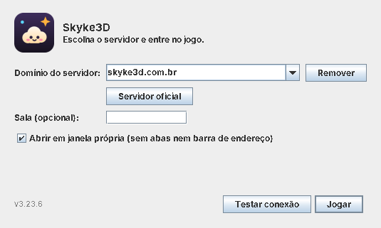

# Launcher do Skyke3D (Java)

Um `.jar` universal (Windows, macOS e Linux) que escolhe **para qual servidor o jogo conecta** e abre o jogo.



- **Domínio do servidor:** digite o domínio (`skyke3d.com.br`, `jogo.meusite.com`, `meu.servidor:8443`, `localhost:3000`...). Sem `https://`, o launcher usa https; para endereços da própria máquina ou da rede local (localhost, 127.x, 192.168.x, 10.x, 172.16–31.x, `*.local`) usa http. Caminho, usuário e senha no endereço são descartados ou recusados.
- **Recentes:** os últimos 8 servidores ficam na lista; **Remover** tira um da lista e **Servidor oficial** volta ao padrão.
- **Sala (opcional):** entra direto na sala com esse código (`#sala=CODIGO`).
- **Testar conexão:** confere se o endereço responde e se é mesmo um servidor do Skyke3D. Avisa quando, sem https, o navegador não vai liberar o microfone (a voz só funciona em https ou em localhost).
- **Jogar:** com **janela própria**, abre o jogo num Chrome, Edge, Brave, Chromium, Vivaldi ou Opera instalado em modo aplicativo (sem abas nem barra de endereço), com um perfil só do launcher; sem nenhum deles, ou com a opção desligada, abre no navegador padrão.

O jogo é o mesmo do site (three.js, WebGL e Web Audio), sempre atualizado: o launcher não guarda nem altera nada do jogo. Como o perfil da janela própria é separado do navegador, a identidade de lá é outra; use o **código de recuperação** para levar a sua.

## Usar

Precisa de Java 11 ou mais novo. Baixe `skyke3d-launcher.jar` do [Release mais recente](https://github.com/Noturno-Strange/skyke3d/releases/latest) e dê dois cliques, ou:

```bash
java -jar skyke3d-launcher.jar                         # abre o launcher
java -jar skyke3d-launcher.jar meu.servidor.com        # já com este domínio no campo
java -jar skyke3d-launcher.jar -s meu.servidor.com -r ABC123 --jogar   # abre o jogo direto, sem a janela
java -jar skyke3d-launcher.jar -s meu.servidor.com --testar            # só testa a conexão (código de saída 0 = ok)
java -jar skyke3d-launcher.jar --ajuda
```

Os ajustes ficam em `launcher.properties`: `%APPDATA%\Skyke3D` no Windows, `~/Library/Application Support/Skyke3D` no macOS e `~/.config/skyke3d` no Linux (ali também fica a pasta `janela`, o perfil da janela própria).

## Gerar

```bash
launcher/build.sh                                  # → launcher/build/skyke3d-launcher.jar (padrão: skyke3d.com.br)
SKYKE_URL=meu.servidor.com launcher/build.sh       # grava outro servidor padrão no .jar (a pessoa ainda pode trocar)
```

O script compila para Java 11 (`--release 11`, avisos viram erro), roda os testes de `test/` e monta o `.jar` com datas fixas. O CI faz o mesmo a cada push e anexa o `.jar` ao Release.
